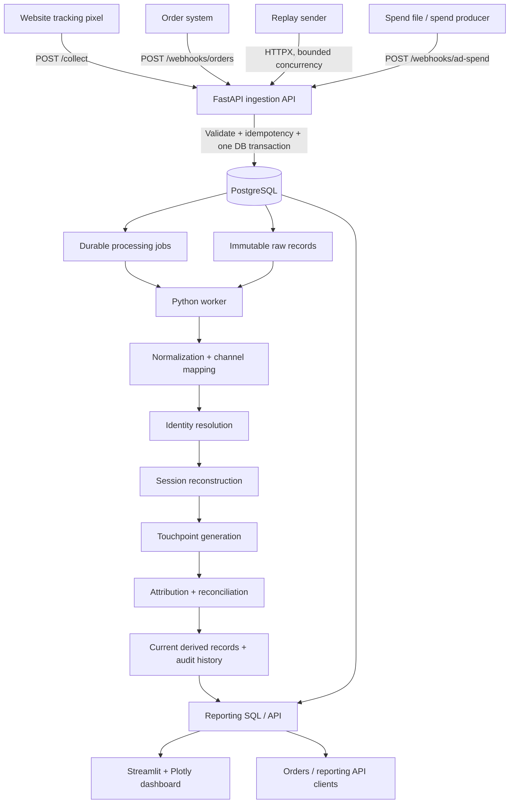
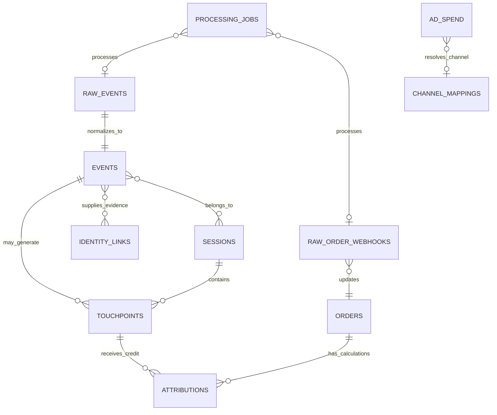

# Urban Thread — First-Party Attribution Pipeline

## Architecture and engineering design

**Status:** Proposed implementation baseline  
**Architecture style:** Modular monolith with asynchronous, recoverable processing  
**Primary stack:** Python 3.12+, FastAPI, PostgreSQL, SQLAlchemy 2.0, Alembic, HTTPX, Pytest, Streamlit and Plotly  
**Primary attribution model:** Literal last-click, 30-day lookback (configurable)  
**Session inactivity threshold:** 30 minutes  

> **Data-contract warning:** The assignment describes the input files and approximate sizes, but the actual `urbanthread_data_sep2026.zip` and its README/data dictionary were not available when this design was written. Table and API designs below are canonical internal contracts, not claims about the source files' exact column names. Before implementing source adapters, inspect the ZIP, profile every field, and complete the mapping checklist in this document. Do not invent or silently assume source columns.

---

## 1. Executive architecture decision

Build a first-party marketing data ingestion and attribution platform that accepts website events, order webhook updates and daily advertising spend; preserves the source evidence; reconstructs visitor sessions and customer identity; attributes eligible paid orders to marketing touchpoints; and exposes reconciled channel/day metrics through an API and a modestly polished dashboard.

The system is a **modular monolith**, not a collection of microservices. It has three independently runnable processes sharing one codebase and one PostgreSQL database:

1. **API process** — validates and durably accepts incoming records.
2. **Worker process** — normalizes records, resolves identity, rebuilds sessions and recalculates attribution.
3. **Dashboard process** — reads reporting APIs and presents the reconciled results.

A replay sender acts as a test producer. It submits the files over HTTP; it must never write directly to PostgreSQL.

### Why this design

- Correctness is concentrated in a small number of well-defined domain modules.
- Raw ingestion is independent of slow or retryable analytical processing.
- PostgreSQL provides transactional persistence, constraints, analytical SQL and a durable queue without introducing Kafka, Redis or Celery.
- The same system can accept the September backfill and the October 1–3 follow-up without a date-specific code path.
- Derived sessions and attribution can be rebuilt when late events or identity links arrive.
- Attribution is deterministic and explainable; an LLM is not used to assign revenue.

## 2. Architecture at a glance



### Data flow

```text
Source file / producer
        |
        v
HTTP ingestion endpoint
        |
        +--> validate envelope and source-specific schema
        |
        +--> persist immutable raw payload
        |
        +--> enqueue durable job (same transaction)
        |
        v
202 Accepted

Worker claims job with a lease
        |
        v
Normalize source data and record data-quality outcomes
        |
        v
Resolve visitor/customer identity conservatively
        |
        +--> rebuild affected visitor sessions
        |
        +--> rebuild eligible touchpoints
        |
        +--> reconcile affected orders
        |
        v
Current attribution + immutable calculation lineage
        |
        v
Reporting API --> Dashboard
```

## 3. Technology choices

| Concern | Choice | Reason / boundary |
|---|---|---|
| Runtime | Python 3.12+ | One language for API, replay, processing and analytics |
| HTTP API | FastAPI | Typed contracts, validation, OpenAPI and dependency injection |
| Database | PostgreSQL 16+ | Transactions, JSONB raw payloads, constraints, window functions and queue locking |
| Persistence | SQLAlchemy 2.0 + psycopg | ORM for operational writes; explicit SQL for analytics and complex reporting |
| Schemas | Pydantic v2 | API validation and normalized data contracts |
| Migrations | Alembic | Versioned, reviewable schema evolution |
| Background processing | Small PostgreSQL-backed worker | Durable jobs and `FOR UPDATE SKIP LOCKED`; no extra broker for this workload |
| Replay | HTTPX + asyncio | Bounded concurrent HTTP submissions with retry and progress reporting |
| Dashboard | Streamlit + Plotly | Fast to build, simple filters and clear charts |
| Tests | Pytest | Domain, integration, concurrency and end-to-end coverage |
| Quality | Ruff, mypy (or Pyright) | Consistent style and useful static checks |
| Local environment | Docker Compose + Makefile | Reproducible one-command startup |

### Explicitly not in the initial design

Kafka, Redis, Celery, Airflow, Kubernetes, microservices, MongoDB, a separate distributed lock service, a data warehouse and LLM-based attribution are out of scope. Add one only when a demonstrated requirement justifies its operational cost.

## 4. Bounded contexts and code ownership

| Module | Owns | Must not own |
|---|---|---|
| `ingestion` | HTTP contracts, request validation, raw persistence, idempotency and job enqueue | Session or attribution business rules |
| `normalization` | Mapping source payloads to stable internal fields; channel taxonomy | Rewriting raw payloads |
| `identity` | Visitor/customer links, evidence, temporal boundaries and conflict handling | Guessing identities from IP/device similarity |
| `sessions` | Visitor-scoped 30-minute session reconstruction | Customer-level identity merging |
| `touchpoints` | Identifying eligible marketing interactions and preserving source metadata | Crediting arbitrary page views |
| `attribution` | Deterministic model, lookback, selection and lineage | HTTP, database session or dashboard concerns |
| `orders` | Canonical order state and financial eligibility | Counting webhook deliveries as orders |
| `spend` | Daily campaign spend normalization and channel mapping | Allocating spend to campaigns without a valid key |
| `reporting` | Date-bounded aggregation and metric definitions | Recomputing journeys on dashboard requests |
| `workers` | Leases, retries, job routing and orchestration | Duplicating domain logic |
| `dashboard` | Visual presentation and filtering | Reimplementing attribution calculations |

The dependency direction is inward: API and infrastructure depend on application/domain modules; domain logic does not import FastAPI, SQLAlchemy or Streamlit.

### Suggested project structure

```text
urban-thread-attribution/
├── app/
│   ├── main.py
│   ├── api/v1/
│   │   ├── router.py
│   │   └── endpoints/
│   │       ├── events.py
│   │       ├── orders.py
│   │       ├── ad_spend.py
│   │       ├── reports.py
│   │       └── health.py
│   ├── core/
│   │   ├── config.py
│   │   ├── logging.py
│   │   ├── security.py
│   │   └── errors.py
│   ├── domain/
│   │   ├── models/
│   │   ├── policies/
│   │   └── services/
│   ├── application/
│   │   ├── commands/
│   │   ├── handlers/
│   │   └── ports/
│   ├── infrastructure/
│   │   ├── db/
│   │   ├── repositories/
│   │   └── source_adapters/
│   ├── workers/
│   │   ├── runner.py
│   │   ├── queue.py
│   │   └── handlers.py
│   └── cli.py
├── dashboard/
│   └── app.py
├── scripts/
│   ├── replay.py
│   └── inspect_dataset.py
├── migrations/
├── tests/
│   ├── unit/
│   ├── integration/
│   └── e2e/
├── data/                 # local input files; gitignored
├── queries.sql
├── docker-compose.yml
├── Dockerfile
├── Makefile
├── pyproject.toml
├── alembic.ini
├── .env.example
├── .gitignore
├── claude.md
├── PRD.md
├── architecture.md
└── README.md
```

## 5. Dataset contract and inspection gate

The assignment identifies these files and approximate volumes:

| Source file | Stated purpose | Approximate volume | Ingestion path |
|---|---|---:|---|
| `events.jsonl` | Website events captured by the store tracking pixel, listed in server-received order | ~56,000 events | `POST /collect` |
| `orders.csv` | Order-system webhook messages; a row is a webhook and an order can have multiple updates | ~1,150 webhooks | `POST /webhooks/orders` |
| `ad_spend.csv` | Daily spend per campaign from Meta, Google and TikTok | ~230 rows | `POST /webhooks/ad-spend` |

These sizes are assignment-provided approximations, not counts independently verified from the ZIP.

### Mandatory inspection before schema finalization

Run a dataset inspection utility before writing source-specific adapters. The inspection must report:

- File encoding, delimiter, JSONL validity and row counts.
- Exact field names, data types, null counts, distinct counts and sample values.
- Candidate event ID, webhook delivery ID, order ID, visitor ID and customer ID fields.
- Event occurrence time versus received/updated time fields, including timezone and parse failures.
- Actual event types, order statuses, payment/refund representations and currency values.
- How marketing data is represented: UTM source/medium/campaign, referrer, click IDs or platform fields.
- Whether ad spend has stable campaign IDs, daily dates, amounts and currencies.
- Duplicate keys, inconsistent casing, schema variants, negative values and suspicious timestamps.
- Whether a customer identifier is genuinely shared across devices.

Record the findings in a `docs/data-dictionary.md` or in the README before implementing source mapping. Keep a sample of malformed/unusual rows with sensitive values redacted.

### Mapping rules

1. Preserve every original source payload in a raw table.
2. Normalize known fields into typed internal columns without destroying source values.
3. Treat an unknown optional field or channel as data to preserve, not automatically as a bad record.
4. Reject or quarantine structurally invalid records; do not silently replace invalid timestamps with server time.
5. Do not infer cross-device identity from IP address, user-agent, geography or behavioural similarity.
6. Do not infer a paid channel from `utm_source` alone. Source and medium (plus verified click identifiers where available) determine classification.
7. If a required identifier is absent, retain the raw evidence and mark the record unresolved where the contract permits it.

## 6. Logical data model

The schema is a logical target. Field-level source mapping is finalized after inspecting the actual files.

### Core tables

| Table | Purpose | Key constraints / notes |
|---|---|---|
| `raw_events` | Immutable website event payloads | Unique `(source, external_event_id)` where a trustworthy external ID exists; store `received_at`, file/record sequence and JSONB payload |
| `events` | Normalized event facts | One-to-one with raw event; typed `visitor_id`, `customer_id`, `event_type`, `occurred_at`, UTM/referrer fields and quality state |
| `raw_order_webhooks` | Immutable order webhook deliveries | Deduplicate by webhook delivery ID, not by order ID; retain each legitimate order update |
| `orders` | Canonical current order state | One row per source order ID; preserve status, currency, amount fields, `paid_at`, source version/update timestamp |
| `identity_links` | Evidence-backed visitor/customer associations | Temporal links with evidence, `valid_from`, optional `valid_to`, status and conflict state |
| `sessions` | Reconstructed visitor sessions | Visitor-scoped; stores start/end, duration, event count and boundary event IDs |
| `touchpoints` | Eligible normalized marketing interactions | References event and session; stores channel/source/medium/campaign and occurrence time |
| `ad_spend` | Daily campaign/platform spend | Store date, platform, campaign key/name, channel mapping, amount and currency; unique key only where source semantics support it |
| `attributions` | Current and historical attribution decisions | Order/model/policy lineage, touchpoint, channel, conversion time, revenue, currency, reason and calculation time |
| `processing_jobs` | Durable background work | Lease, attempts, availability, status and error metadata |
| `data_quality_issues` | Explicit data-quality findings | Source record reference, rule, severity, status and diagnostic details |
| `channel_mappings` | Auditable source-to-channel rules | Match dimensions and canonical channel; versioned or timestamped changes |

### Conceptual entity relationships



### Important data types and constraints

- Use `TIMESTAMPTZ` for event, receipt, order and processing timestamps.
- Use `DATE` for daily spend dates.
- Use `NUMERIC(18, 4)` or a carefully chosen integer minor-unit representation for money; never use binary floating point for money.
- Store `currency` alongside every order and spend amount. Do not aggregate across currencies without an explicit FX policy and rate data.
- Use JSONB for original payloads; normalized business fields remain typed columns.
- Use source IDs as external identifiers and generated UUIDs as internal primary keys.
- Add indexes based on query paths: `(visitor_id, occurred_at)`, `(customer_id, occurred_at)`, `(order_id, model, is_current)`, `(paid_at, currency)`, and spend date/channel keys.
- Use migrations. Do not recreate tables automatically at application startup.

### Data immutability and derived state

Raw events and raw webhooks are append-only evidence. Corrections create new derived results; they do not rewrite source payloads. Sessions, touchpoints, resolved identity projections and current attribution can be rebuilt from raw evidence plus versioned policies.

For attribution audit history, retain older calculations with `is_current = false` (or an equivalent versioned calculation table). Enforce at most one current result per `(order_id, model)` using a partial unique index.

## 7. Ingestion and API design

All ingestion endpoints acknowledge receipt only after the raw record and its processing job are committed in the same database transaction.

### `POST /collect`

Accepts one website event per request, as required by the assignment. The adapter maps the actual source payload to the internal event envelope.

Canonical conceptual fields (not assumptions about source field names):

```json
{
  "event_id": "source-event-id-if-present",
  "visitor_id": "visitor-123",
  "customer_id": null,
  "event_type": "page_view",
  "occurred_at": "2026-09-10T10:00:00Z",
  "utm_source": "google",
  "utm_medium": "cpc",
  "utm_campaign": "campaign-a",
  "referrer": null
}
```

The actual source adapter must use the fields found in the ZIP README and source data. Do not require optional fields that the source does not provide.

### `POST /webhooks/orders`

Accepts one order webhook update. Store every distinct delivery. Update the canonical order only when the incoming update is newer according to a trustworthy source version or source update timestamp. Never use `order_id` as the webhook deduplication key.

If the provider supports signatures, verify HMAC over the raw request body using a secret from environment configuration, compare signatures in constant time and enforce timestamp/replay tolerance where supported. For the local replay, use a development secret and document how the sender signs requests.

### `POST /webhooks/ad-spend` (supporting endpoint)

The assignment requires spend to be used in reporting but does not prescribe an endpoint. This endpoint gives spend the same auditable ingestion path and prevents direct database loading. Store one daily campaign/platform record per request. Deduplicate only on a reliable upstream record ID or a verified natural key.

### Response semantics

| Situation | Response |
|---|---:|
| Persisted and queued | `202 Accepted` |
| Previously accepted duplicate | `200 OK` or `202 Accepted`, with duplicate indicator |
| Malformed JSON | `400 Bad Request` |
| Valid JSON but invalid contract | `422 Unprocessable Entity` |
| Invalid/missing webhook authentication | `401 Unauthorized` |
| Payload too large | `413 Payload Too Large` |
| Rate limit exceeded | `429 Too Many Requests` |
| Temporary database/availability problem | `503 Service Unavailable` |

Never return success if the database transaction failed. A successful HTTP response means durable acceptance, not completion of the downstream attribution job.

### Reporting endpoints

| Endpoint | Purpose |
|---|---|
| `GET /api/v1/reports/channels?start_date=YYYY-MM-DD&end_date=YYYY-MM-DD` | Orders, attributed revenue, spend and ROAS grouped by channel and currency |
| `GET /api/v1/reports/daily?start_date=...&end_date=...` | Daily revenue/spend/ROAS series by channel and currency |
| `GET /api/v1/orders?start_date=...&end_date=...&channel=...&limit=...&cursor=...` | Paginated order ledger with attribution status |
| `GET /api/v1/orders/{order_id}` | Order details and attribution explanation |
| `GET /health` | Process liveness |
| `GET /ready` | Database connectivity and readiness |

Use date-only filters with inclusive user semantics and half-open timestamp predicates internally: `timestamp >= start` and `timestamp < day_after_end`, after converting the selected dates using the configured reporting timezone.

### Example channel response

```json
{
  "date_range": {
    "start_date": "2026-09-01",
    "end_date": "2026-09-30",
    "timezone": "UTC"
  },
  "currency": "INR",
  "attribution_model": "last_click",
  "lookback_days": 30,
  "channels": [
    {
      "channel": "Google Ads",
      "orders": 25,
      "revenue": "125000.00",
      "ad_spend": "25000.00",
      "roas": 5.0,
      "spend_status": "available"
    }
  ]
}
```

Illustrative shape only; values and source-field names are not dataset results.

## 8. Replay sender design

The replay sender is a first-class component of the assignment, not a convenience script.

### Responsibilities

1. Read JSONL and CSV inputs from disk; never connect to PostgreSQL.
2. Validate file readability and report malformed rows with line numbers.
3. Submit `events.jsonl` records to `/collect`, order rows to `/webhooks/orders`, and spend rows to `/webhooks/ad-spend`.
4. Preserve each file's source order when scheduling requests; include source filename and line/record sequence as diagnostic metadata where appropriate.
5. Use bounded concurrency, configurable between 10 and 20 (default 15).
6. Retry network failures, timeouts, HTTP 429 (respect `Retry-After`) and retryable 5xx responses with exponential backoff and jitter.
7. Do not automatically retry permanent 4xx validation/authentication failures.
8. Keep source event/webhook IDs stable across retries.
9. Report submitted, accepted, duplicate, retried, rejected and permanently failed counts, plus a failure file containing source row references.
10. Exit non-zero if records remain permanently failed.

Concurrency can reorder network completion. Backend correctness must rely on source occurrence/version timestamps and stable identifiers, not HTTP arrival order or file line order. File order is preserved as the replay submission sequence because that is part of the assignment's producer simulation.

### Suggested CLI contract

```bash
python -m scripts.replay \
  --events data/events.jsonl \
  --orders data/orders.csv \
  --ad-spend data/ad_spend.csv \
  --base-url http://localhost:8000 \
  --concurrency 15
```

Provide `--only events|orders|spend`, `--resume` (if implemented safely), `--dry-run`, timeout and retry controls. A restart/replay must be safe due to endpoint idempotency. Do not promise exactly-once delivery; implement at-least-once delivery with idempotent effects.

## 9. Background processing

### Transactional enqueue

For each successful ingestion request:

1. Validate and normalize only the envelope fields needed for routing.
2. Insert the immutable raw row (or detect a duplicate by a trustworthy source key).
3. Insert a processing job or increment the generation of a dirty identity key.
4. Commit both in one transaction.
5. Return `202`.

This prevents a record from being accepted without durable downstream work.

### Job model

Recommended fields:

```text
id, job_type, entity_type, entity_id, dedupe_key,
status, attempts, max_attempts, available_at,
locked_by, locked_until, last_error, created_at,
started_at, completed_at
```

Worker claim pattern:

```sql
SELECT id
FROM processing_jobs
WHERE status IN ('pending', 'retry')
  AND available_at <= now()
ORDER BY created_at, id
FOR UPDATE SKIP LOCKED
LIMIT :batch_size;
```

Claim and lease update must occur in the same transaction. Expired leases are reclaimable. The worker must use short transactions to claim and longer bounded transactions to apply derived changes.

### Reliability policy

- **At-least-once processing:** a job may execute more than once; writes must be idempotent.
- **Lease recovery:** a job whose `locked_until` expires can be reclaimed after a worker crash.
- **Retryable failures:** database/network/transient dependency failures use exponential backoff with jitter.
- **Permanent failures:** invalid source data and impossible business states become dead-letter jobs with reason and source reference.
- **Per-identity serialization:** use a PostgreSQL advisory lock or an equivalent row lock while rebuilding a visitor/customer journey, so two workers cannot concurrently write conflicting sessions/attributions for the same identity.
- **Coalescing:** repeated changes for one identity may collapse into one dirty-identity reconciliation job. Do not lose changes while a reconciliation is running; compare a generation/version before marking the identity clean.
- **No exactly-once claim:** HTTP and workers can retry. The guarantee is idempotent business effects, not exactly-once execution.

### Processing handlers

| Job | Main operation | Idempotent result |
|---|---|---|
| `normalize_event` | Normalize event, classify channel and update identity evidence | One normalized event per raw event |
| `reconcile_visitor` | Rebuild sessions and touchpoints for one visitor | Deterministic session/touchpoint state |
| `reconcile_customer` | Re-evaluate journey across linked visitors and affected orders | One current attribution per order/model |
| `apply_order_webhook` | Validate version and update canonical order state | One canonical order, latest valid state |
| `ingest_spend` | Normalize daily campaign spend | One accepted spend fact per source key |
| `reconcile_order` | Recalculate one order's attribution | One current attribution per model |

A simpler initial implementation may route `normalize_event` to a visitor reconciliation handler. Keep the handler idempotent and ensure the raw record is durable before processing.

## 10. Identity resolution

Identity resolution and sessionization are separate responsibilities.

- A **visitor** represents a browser/device identifier.
- A **customer** represents a stable account/buyer identifier supplied by a trusted source.
- A **session** belongs to one visitor, not to a customer.
- A **customer journey** may span multiple visitor IDs only when a reliable identifier connects them.

### Policy

1. Link visitors to customers only using explicit source evidence (for example, an event carrying both IDs, a trustworthy login association or an order carrying both IDs).
2. Store when the link became valid, how it was established and which source record supports it.
3. Treat links as temporal. A shared device can be used by more than one customer; never rewrite the entire device history to the latest customer without evidence.
4. Historical anonymous events may be attached to a customer only under an explicit backfill policy (for example, within the configured lookback before a confirmed login) and only if there is no conflicting customer link in that interval.
5. If one visitor is associated with conflicting customer IDs, retain the conflict and keep ambiguous events unresolved; do not silently overwrite the mapping.
6. Do not merge people based on IP address, user-agent, approximate location or similar behaviour.
7. A guest order with no reliable visitor/customer/check-out relationship remains a valid order but is `Unattributed`.

**Conservative principle:** a missed identity link is preferable to a false merge that credits one person's marketing journey to another person's purchase.

## 11. Sessionization

Sessionization is visitor-scoped and uses `occurred_at`, never request receive order.

- Sort by `occurred_at ASC`, then stable event ID as a deterministic tie-breaker.
- A new session starts only when the gap between consecutive valid events is **greater than 30 minutes**.
- Exactly 30 minutes remains in the same session. This interpretation follows “after 30 minutes”; document it and test it.
- Multiple events with the same timestamp remain in one session.
- A session can cross midnight and file boundaries.
- A single-event session has duration zero.
- A session's duration is `last_event_at - first_event_at`; long sessions remain one session if every adjacent gap is within threshold.
- Late events can bridge two previously separate sessions. Rebuild the affected visitor's sessions from source events rather than trying to patch boundaries in place.
- Events without a usable visitor ID can be retained but cannot be visitor-sessionized.

For the SQL assignment, group each session under the **local calendar date of its start**, using `REPORTING_TIMEZONE`. State this convention in `queries.sql` and README. The SQL must use the same `> INTERVAL '30 minutes'` boundary rule.

## 12. Marketing touchpoints and channel normalization

Not every website event is a marketing touchpoint. A product view or add-to-cart event must not overwrite the acquisition source simply because it happened later.

A touchpoint is created from a verified acquisition/landing/referral/campaign interaction. The exact eligible event types and fields must be selected after inspecting the event schema. Candidate evidence includes UTM source/medium/campaign, recognized advertising click IDs, or a recognized external referrer.

### Channel normalization

Use a deterministic, auditable mapping based on source + medium + available click/referrer evidence. Preserve all original values.

Illustrative mapping rules (final rules require source-data validation):

| Evidence | Canonical channel |
|---|---|
| Verified paid Google campaign / `cpc`-like medium | Google Ads / Paid Search |
| Verified Meta paid campaign / paid-social medium | Meta Ads / Paid Social |
| Verified TikTok paid campaign | TikTok Ads / Paid Social |
| Recognized email medium | Email |
| Search engine referral without paid evidence | Organic Search |
| Social referral without paid evidence | Organic Social / Referral |
| Explicit direct landing evidence with no campaign/referrer | Direct |
| Insufficient or unknown source evidence | Unknown |

Do not map `google` to Google Ads from source alone; it may be organic. Unknown values stay visible as `Unknown` until mapped. The mapping table should be inspectable and testable.

## 13. Attribution policy

### Primary model: literal last-click

The primary model will satisfy the assignment's plain-language request. The latest **eligible marketing touchpoint**, including an explicitly evidenced Direct touchpoint, receives 100% credit for each eligible order.

| Rule | Primary policy |
|---|---|
| Model | `last_click` |
| Lookback | 30 days by default; configurable |
| Conversion timestamp | `paid_at` where available and semantically valid; otherwise a verified paid/conversion timestamp chosen after source inspection |
| Eligible time boundary | `touchpoint.occurred_at <= conversion_at` |
| Lookback boundary | `touchpoint.occurred_at >= conversion_at - 30 days` (inclusive) |
| After-order events | Never eligible |
| Tie timestamps | Use a trustworthy source sequence if available; otherwise stable deterministic tie-break and mark ambiguity where causal order is unknown |
| Multiple orders | Calculate independently for each order |
| No eligible evidence | `Unattributed`; do not use Direct as a catch-all |
| Direct | Included as a last-click candidate only when explicit direct-landing evidence exists |
| Late touchpoint / identity link | Recalculate affected historical orders |

Why literal last-click: it avoids silently redefining the requested model. Some marketing teams use **last non-direct click**, where a direct visit does not overwrite a prior campaign. That can be implemented as a separate `last_non_direct` strategy or policy option and compared as a bonus, but must not be presented as the primary model unless the reviewer explicitly defines “last click” that way.

### Attribution algorithm

For each currently eligible paid order:

1. Resolve the buyer identity using the order's trusted customer/visitor identity and confirmed temporal links.
2. Retrieve eligible touchpoints belonging to that resolved identity.
3. Filter to `[conversion_at - lookback, conversion_at]`.
4. Select the latest eligible touchpoint by occurrence time and deterministic tie-break.
5. Attribute 100% of the order's revenue amount to that channel.
6. If none exists, record `Unattributed` (or `Direct` only where a qualifying direct touchpoint is present).
7. Persist selected event/touchpoint, identity evidence, conversion timestamp, lookback, policy version, amount/currency, reason and calculated timestamp.

The decision function must be pure domain logic: same orders, touchpoints and policy produce the same result.

### Reconciliation triggers

Recalculate affected attributions when:

- A new event or touchpoint is received for a visitor/customer.
- A confirmed identity link is created or corrected.
- An order becomes paid, is cancelled, is refunded or receives a correction.
- A channel-mapping policy changes.
- A manual reconciliation command is run.

For a new touchpoint, a candidate order is affected when its conversion time is at or after the touchpoint and within the lookback window. For an identity-link correction, recalculate all orders in the affected identity scope. Do not freeze attribution merely because an order was processed before its event arrived.

## 14. Orders and revenue semantics

An order is not a webhook. There may be many deliveries and legitimate state transitions for one `order_id`.

- Preserve every distinct webhook in `raw_order_webhooks`.
- Maintain one canonical current order per source order ID.
- Apply an update only if its source version is newer, or its trusted source update timestamp is newer.
- If neither is present, use receive time only as a documented fallback and mark ordering confidence as weak; never pretend it is a reliable source ordering signal.
- Unpaid, pending and failed orders do not contribute to paid revenue.
- Cancelled orders are excluded from paid revenue according to the selected business policy, but their state/history is retained.
- Refunds reduce net revenue only when the source provides reliable refund amounts/status. Keep original paid amount and refund adjustments traceable.
- Do not merge different order IDs just because customer and amount match.
- Use the dataset's actual financial fields to decide whether reported revenue is gross, paid, net of discount, net of refund, inclusive/exclusive of tax or shipping. Record that decision in `docs/data-dictionary.md` and README.
- Preserve currency on every amount. Do not add INR, USD and EUR together.

Until field semantics are verified, name the canonical measure `revenue_amount` and keep raw monetary components. Do not label it “net revenue” without evidence.

## 15. Advertising spend and ROAS

Spend is a daily fact at the granularity supplied by the source (likely platform + campaign + date, but verify). Attribution may be at channel level. Aggregate both at the lowest common trustworthy granularity, normally channel + day + currency.

- Prefer stable platform campaign IDs for mapping.
- If only campaign names exist, use explicit exact mappings and flag unmatched names; avoid fuzzy matching that silently moves spend.
- Do not allocate channel spend across campaigns unless a valid allocation rule exists.
- Missing spend is **not** zero spend.
- Zero spend with positive revenue yields `ROAS = NULL` (undefined), not infinity.
- Spend with no attributed revenue yields ROAS `0`.
- Aggregate ROAS as `SUM(attributed_revenue) / SUM(ad_spend)`, never as an average of daily or campaign ROAS values.
- Group totals by currency. No FX conversion unless the source includes a trustworthy rate and a documented conversion policy.
- Use spend date for spend and order paid/conversion date for revenue; these are distinct date bases.

## 16. Reporting and dashboard semantics

### Metric definitions

| Metric | Definition |
|---|---|
| Paid orders | Distinct canonical orders currently eligible under paid-order policy in selected conversion-date range |
| Attributed orders | Paid orders with a current attribution row; include Unattributed as a visible bucket |
| Attributed revenue | Sum of the chosen order revenue basis assigned once per eligible order |
| Ad spend | Sum of accepted spend facts by spend date, channel and currency |
| ROAS | Attributed revenue divided by ad spend for matching channel/date range/currency |
| Unattributed revenue | Revenue of eligible paid orders with no reliable matching touchpoint |
| Data freshness | Latest source `received_at` and latest successful processing time |
| Processing backlog | Pending/retry/leased/dead-letter job counts |

Reports must state attribution model, lookback, reporting timezone and currency. An order with no spend record must display spend as unavailable/missing, not as a fabricated zero. ROAS may be null when spend is zero or missing.

### Dashboard layout (slightly polished, not overbuilt)

1. **Header:** Urban Thread · Marketing Attribution, date-range filter, data-freshness/processing status.
2. **KPI row:** Attributed revenue, paid orders, ad spend, blended ROAS. Show currency and definitions in help text.
3. **Daily trend:** Revenue and spend over the selected period; optional channel selector.
4. **Channel performance:** Channel, orders, revenue, spend, ROAS and unattributed/unknown indicators.
5. **Order drill-down:** Filter/search paid orders and inspect selected attribution reason/touchpoint.
6. **Data quality strip:** Unresolved identities, unknown channels, missing spend mappings and failed jobs.

Visual direction: neutral background, clear typographic hierarchy, restrained accent color, consistent number formatting, readable tables, sensible empty/loading/error states. No animation or complex navigation is necessary. The dashboard consumes reporting APIs; it does not duplicate business logic.

## 17. SQL assignment design

### Query 1 — Sessions and median session length per day

Use a CTE pipeline:

1. Read valid normalized `events` with a visitor ID.
2. Order by `visitor_id`, `occurred_at`, stable event ID.
3. Use `LAG(occurred_at)` to find the previous event.
4. Mark a new session when the gap is strictly greater than 30 minutes (or first event).
5. Use cumulative `SUM` to assign a session sequence.
6. Aggregate to session start, end and duration.
7. Group by the local date of `session_started_at` and return session count and `PERCENTILE_CONT(0.5)` median duration.

Do not group individual events by date before sessionization. A session crossing midnight belongs to the date on which it started. A single-event session has zero duration.

### Query 2 — Days to convert

For every paid order:

1. Resolve the buyer's identity using the actual reliable customer-to-visitor links in the schema.
2. Collect all valid visit events for every visitor linked to that customer.
3. Find the earliest observed visit timestamp.
4. Join each paid order to that first visit.
5. Calculate elapsed days as `EXTRACT(EPOCH FROM (paid_at - first_visit_at)) / 86400.0` (fractional elapsed days), unless the reviewer explicitly expects calendar-day difference; state which interpretation is implemented.

If cross-device links are not present in the source, report the earliest visit for the identifiable visitor only and document that the dataset cannot prove the buyer's first visit across devices. Never manufacture customer identity.

## 18. Observability and data quality

Use structured JSON logs with `request_id`, `job_id`, source, source record ID, order ID/visitor ID where appropriate, duration and outcome. Never log secrets or unnecessary personal payload data.

Track at least:

- `events_received`, `events_duplicated`, `events_rejected`, `events_unresolved`
- `order_webhooks_received`, `orders_created_or_updated`, `orders_unattributed`
- `spend_records_received`, `spend_records_unmatched`
- `jobs_pending`, `jobs_retrying`, `jobs_dead_letter`, `jobs_processed`
- `sessions_rebuilt`, `attributions_created`, `attributions_recalculated`

Create `data_quality_issues` for invalid timestamps, missing identifiers, unknown channels, conflicting identity links, invalid financial values, unsupported currencies, unmatched spend and inconsistent order transitions. Keep a reason and source reference.

Reconciliation checks:

- Every accepted raw record is either normalized/processed or has an explicit unresolved/error state.
- One canonical order exists per source order ID.
- No more than one current attribution per order/model.
- No touchpoint after conversion receives credit.
- Every attributed revenue amount has a currency.
- Sum of attributed revenue across channels (including Direct/Unattributed) equals the total eligible revenue for the same date basis and currency.
- Total spend in reporting reconciles to accepted spend facts at the supported granularity.
- Replaying the same dataset leaves logical counts and financial metrics unchanged.

## 19. Failure-mode policy

| Failure / edge case | Expected behaviour |
|---|---|
| Duplicate event with source ID | Unique constraint; acknowledge duplicate without creating a second event |
| Missing event ID | Generate internal ID; do not deduplicate on an unsafe fingerprint |
| Invalid timestamp | Reject or quarantine; never substitute current time |
| Unknown event type/channel | Preserve raw record; mark unknown if structurally valid |
| Out-of-order event | Use `occurred_at`, not received/order sequence |
| Late event | Rebuild affected visitor/customer journey and orders |
| Duplicate order webhook | Deduplicate by webhook ID, not order ID |
| Older order update arrives late | Do not overwrite a newer canonical version |
| Conflicting visitor/customer link | Preserve conflict; leave ambiguous events unresolved |
| Session exactly 30 minutes | Same session under documented strict `>` rule |
| Session crosses midnight | Keep one session; assign SQL daily bucket by session start |
| Order has no identity | Keep valid order; classify revenue as Unattributed |
| Cancelled/unpaid order | Exclude from paid revenue according to documented policy |
| Partial refund | Adjust revenue only from verified refund data |
| No spend record | Mark missing/unavailable, not zero |
| Zero spend | ROAS null |
| Multiple currencies | Separate groups; no implicit conversion |
| Worker crash | Lease expiry and retry; idempotent derived writes |
| Two workers process one identity | Serialize rebuild with a DB lock |
| Poison job | Dead-letter after bounded attempts with diagnostic reason |
| API commits but response is lost | Client retry is harmless due to idempotency |
| HTTP 429 during replay | Respect `Retry-After`; bounded retries |
| App restart between batches | All raw data and job state remain in PostgreSQL |
| September replay followed by October | No date hardcoding; repeat replay is idempotent; sessions can cross file boundary |

## 20. Security and operational safeguards

- Read secrets from environment variables; commit only `.env.example` placeholders.
- Validate HMAC signatures for order webhooks if supported by the simulated producer/source contract.
- Keep local development secrets separate from production secrets.
- Enforce request body size limits and typed validation.
- Do not expose worker/admin reconciliation operations publicly without authentication.
- Use SQL parameterization and least-privilege database credentials.
- Keep personal/customer identifiers out of routine logs and dashboard aggregates.
- Keep local input data and `.env` out of version control.
- Use a separate database for automated tests.

## 21. Test strategy and acceptance invariants

### Unit tests

- Channel mapping and unknown-source behaviour.
- Identity link policy and conflict cases.
- Session boundary: 29m, exactly 30m and 31m.
- Equal timestamps and deterministic tie-breaking.
- Literal last-click including Direct, 30-day inclusive boundary and after-order exclusion.
- Paid/cancelled/refunded revenue policy.
- ROAS with missing spend, zero spend and zero revenue.

### Integration tests (real PostgreSQL)

- Raw insert + job enqueue are atomic.
- Unique event/webhook constraints work under concurrent requests.
- Multiple webhook updates produce one canonical order.
- Older order state cannot overwrite newer state.
- Job leases, `SKIP LOCKED`, retries and recovery work.
- Two workers cannot concurrently corrupt one identity's sessions/attributions.
- Historical attribution can be recalculated after a late touchpoint.

### End-to-end tests

- Start app and worker, replay a small fixture through HTTP, query reporting APIs and verify expected output.
- Replay the same September source records twice and assert no logical/financial metric changes.
- Ingest a simulated October 1–3 batch without restart or schema/date change.
- Restart API/worker between batches and verify pending work is recovered.

### P0 acceptance invariants

1. One logical event per trustworthy source event ID.
2. One canonical order per source order ID.
3. Raw source payloads are immutable.
4. Each eligible order has at most one current attribution per model.
5. A touchpoint after conversion is never eligible.
6. Attribution is deterministic under fixed inputs and policy.
7. Reprocessing does not duplicate sessions, orders, attributions or revenue.
8. Every currency remains explicit.
9. Unknown/unresolved records remain visible rather than silently coerced.
10. The same input records can be safely replayed.

## 22. Scalability and evolution path

The assignment workload is modest. Begin with indexed PostgreSQL tables, bounded worker batches, short transactions and targeted rebuilds. Measure before optimizing.

If volume grows:

- Partition raw event tables by occurrence/receipt date only after measuring maintenance and query needs.
- Move expensive report aggregations to materialized views or pre-aggregated daily facts with explicit refresh/reconciliation semantics.
- Adopt cursor pagination for large order ledgers.
- Add a broker only if the database queue becomes a measured bottleneck or multiple independent consumers need separate delivery semantics.
- Split services only when deployment/team boundaries justify the distributed-system cost.

The core domain policies (identity, sessionization, channel mapping and attribution) should remain portable and deterministic.

## 23. How the design answers the evaluation rubric

| What the reviewer looks for | Evidence in this system | What to demonstrate in the review |
|---|---|---|
| Numbers you can defend | Immutable raw records, explicit mapping, reconciliation checks and attribution lineage | Pick an order and trace its source webhook, conversion timestamp, selected touchpoint, policy and revenue amount |
| Judgement with messy data | Data-quality issues, conservative identity links, Unknown/Unattributed buckets and explicit financial rules | Show an invalid timestamp, unknown channel, conflicting identity or missing spend and explain why it is not silently guessed |
| A system, not a script | HTTP ingestion, persistent PostgreSQL state, durable worker jobs, migrations and replay-safe idempotency | Restart API/worker, replay September again, then ingest October through the same endpoints |
| Clear thinking about scale | Bounded sender/worker concurrency, targeted indexes, per-identity serialization and measured optimization path | Explain likely bottlenecks: repeated identity/session rebuilds, reporting scans and DB write contention; state what metric would justify the next optimization |
| Ownership of your code | Small domain modules, focused services, migrations and tests; domain logic independent of frameworks | Explain and change the session boundary or attribution rule live without modifying ingestion or dashboard code |
| Honest communication | Data dictionary, policy version, quality counters, runbook and documented limitations | State which source fields were verified, which assumptions remain, which tests actually ran and what is not implemented |

Do not invent performance claims. For the supplied workload, report measured replay throughput, worker backlog and query timings from the actual run. The useful senior-level answer is knowing what the first bottleneck is likely to be and what evidence would trigger a change—not adding infrastructure in advance.

## 24. Decisions that must be finalized after dataset inspection

| Decision | Provisional policy | Evidence required before finalization |
|---|---|---|
| Event occurrence timestamp | Source event timestamp | Actual event field and timezone semantics |
| Event idempotency key | External event ID | Whether field exists and uniqueness is stable |
| Visitor/customer keys | Explicit source IDs | Which identifiers are shared between events and orders |
| Order webhook versioning | Source version, then source-updated timestamp | Whether webhook schema supplies either |
| Conversion timestamp | `paid_at` | Actual status/payment fields and business semantics |
| Revenue basis | Verified paid amount, adjusted only by reliable refunds | Meaning of each amount field, discounts/tax/shipping/refunds |
| Currency | Preserve source currency | Actual currencies and scale/precision |
| Channel mapping | UTM source + medium + click/referrer evidence | Actual UTM/referrer conventions and campaign values |
| Spend join | Campaign ID, else exact mapping | Spend campaign identifiers and platform names |
| Reporting timezone | Configurable; UTC fallback | Source/store reporting timezone and spend date semantics |
| Direct classification | Explicit landing/session evidence | Availability and meaning of referrer/UTM values |

Do not claim the implementation is complete until these decisions are recorded in a data dictionary and tested against source examples.

---

## Final engineering position

This should be presented as a **first-party marketing data ingestion and attribution platform**, not merely a dashboard. Its strongest qualities are durable ingestion, conservative identity resolution, deterministic attribution, late-data reconciliation, auditable financial metrics and safe replay. A small system that makes these guarantees explicit is stronger than a larger system with more infrastructure and unverified numbers.
